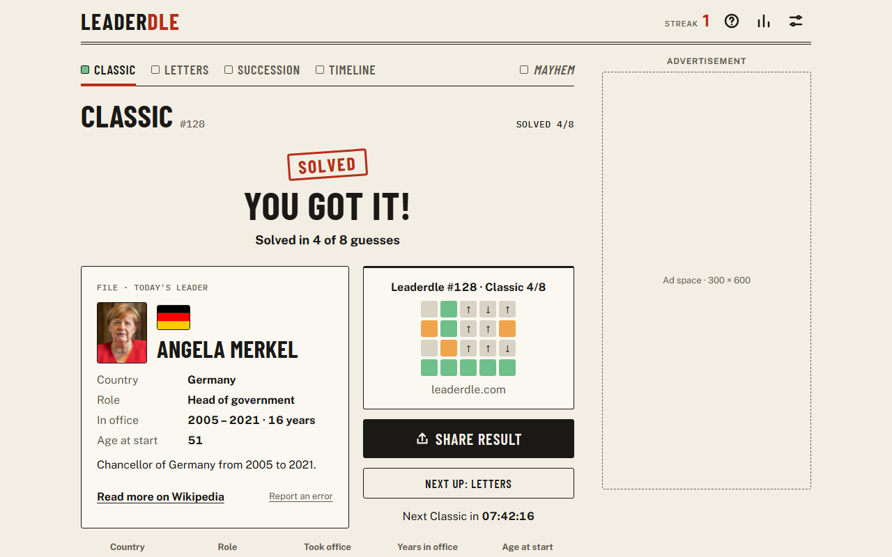
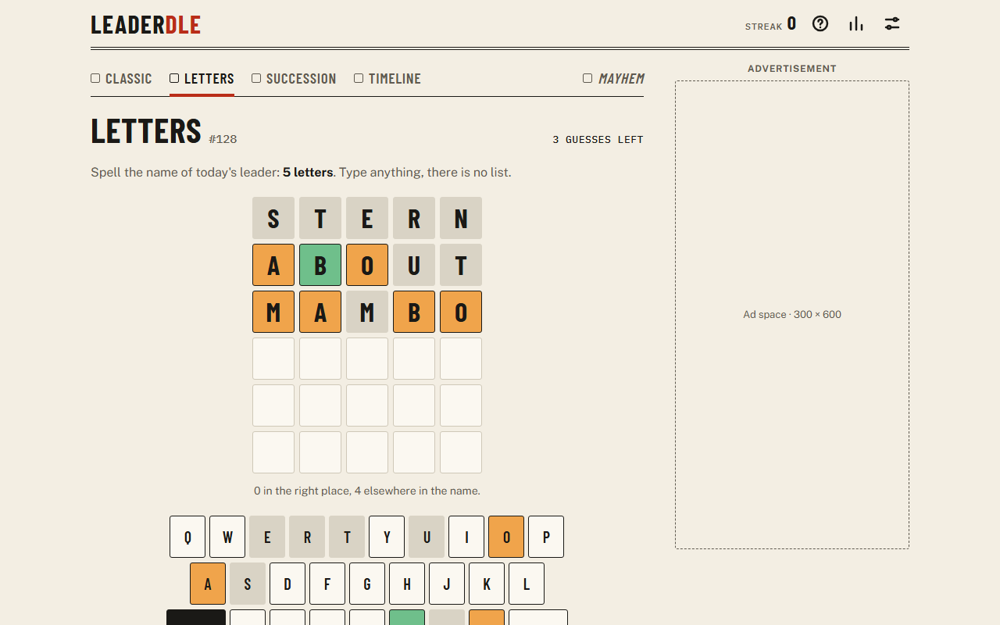
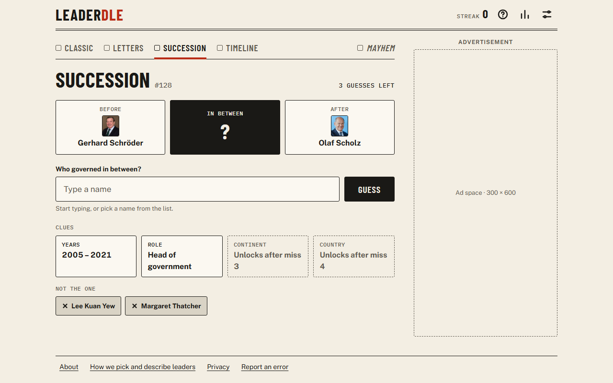
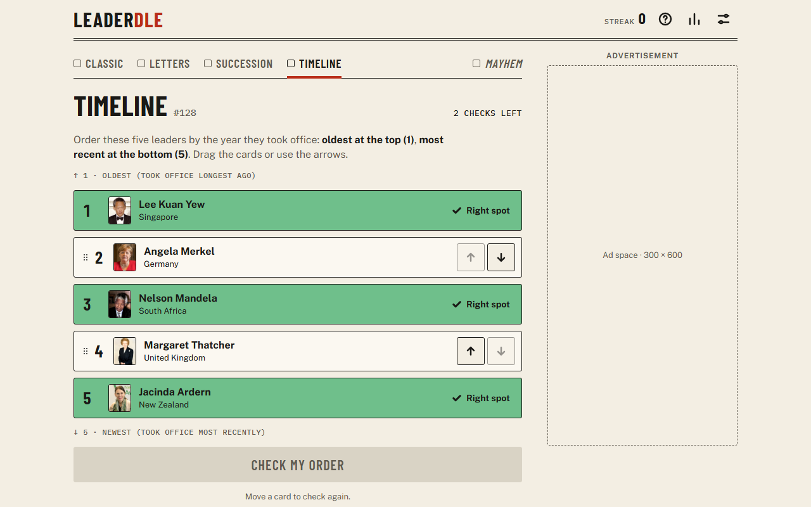
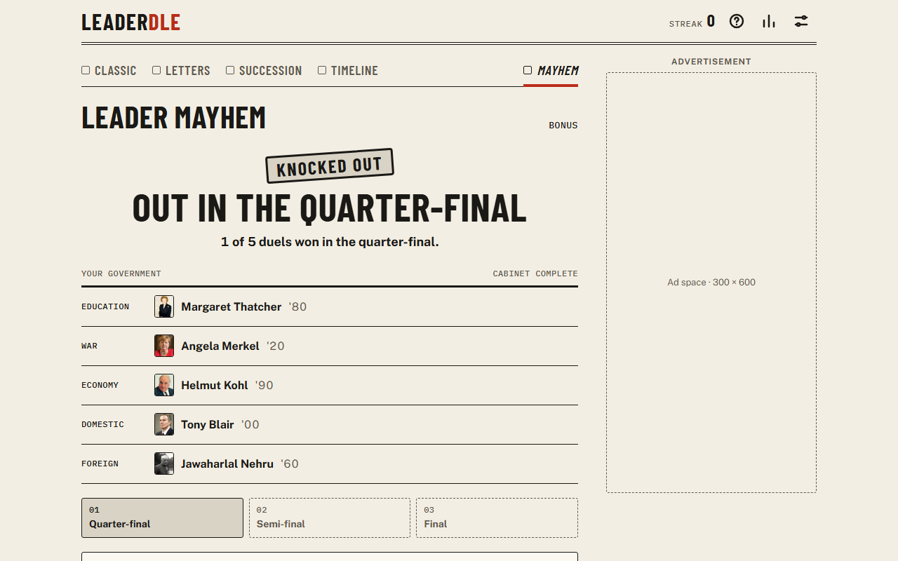
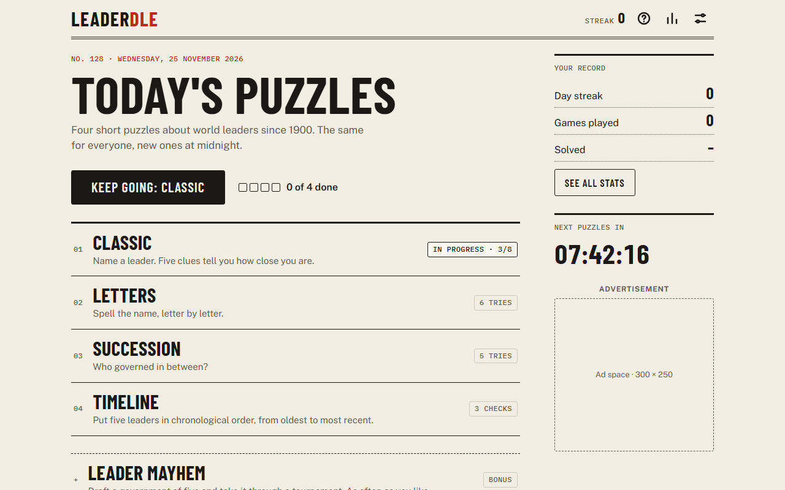
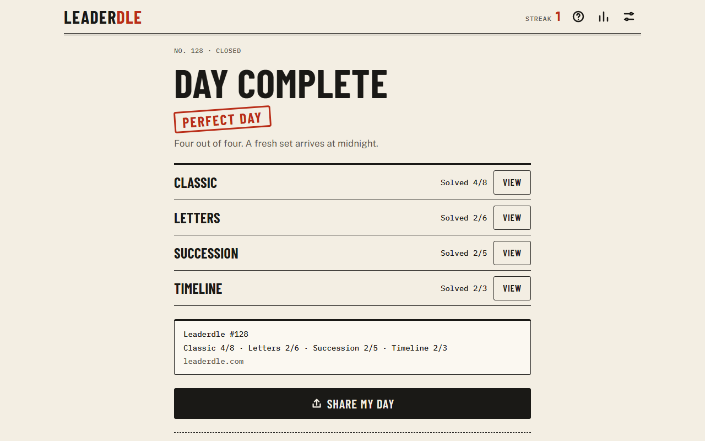
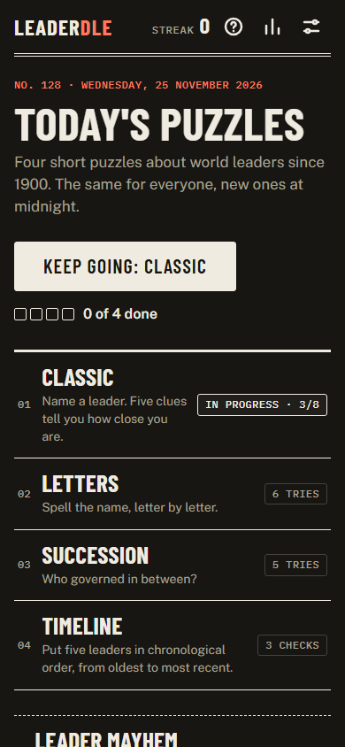
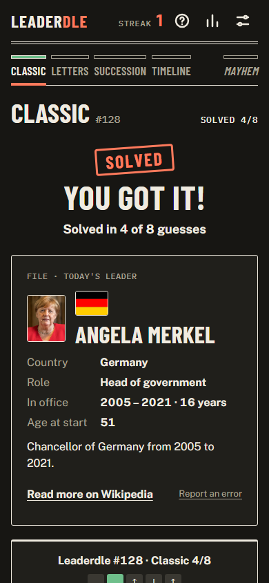
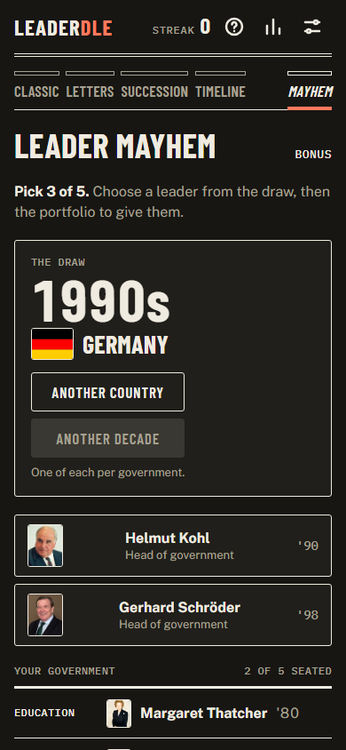

<div align="center">


# Leaderdle

**The daily guessing game about the people who ran the world.**

Four short puzzles a day about heads of state and heads of government since 1900, plus an endless cabinet-drafting tournament.

[](https://react.dev)
[](https://www.typescriptlang.org)
[](https://vite.dev)
[](#how-it-works)
[](#testing)
[](#accessibility)
[](https://www.wikidata.org)

[**Play**](https://leaderdle.com) · [Game modes](#game-modes) · [Quick start](#quick-start) · [Data pipeline](#data-pipeline) · [Contributing](#contributing)



</div>

---

## Why Leaderdle?

- **Four mechanics, one daily docket.** Compare clues, spell a name, fill a gap in a line of succession, put leaders in order. Everyone gets the same puzzles, and they reset at local midnight.
- **Built on real data.** 2,729 guessable leaders from 1900 to today, built from Wikidata and corrected by hand. Daily answers come from 177 well-known leaders, so every puzzle is fair.
- **Neutral by design.** Every leader gets the same treatment, whatever their politics or record. Daily modes show only facts you can check: country, role, dates. No partisan colors and no jokes about the leaders.
- **No account and no friction.** It's a static site that saves your progress in the browser and keeps working offline once loaded. Ads never sit between you and your next guess.
- **Easy to share.** Your result becomes an emoji grid without spoilers, shared through the native share sheet or copied to the clipboard.

## Game modes

| Mode | Goal | Tries |
|---|---|---|
| **Classic** | Guess the leader. Each guess compares five clues: country, role, year they took office, years in office and age at start. A free initials hint unlocks after 5 misses. | 8 |
| **Letters** | Spell the leader's common name, Wordle-style. | 6 |
| **Succession** | Name who held the office between a given predecessor and successor. Each miss reveals a new clue. | 5 |
| **Timeline** | Put five leaders in order by the date they first took office. | 3 checks |
| **Leader Mayhem** *(bonus)* | Pick five leaders for five portfolios (education, war, economy, domestic, foreign affairs), then take your cabinet through a seeded knockout tournament. Play as often as you like. | ∞ |

Win all four daily modes for a **Perfect day**. Your streak grows each day you finish Classic, whether you win or lose.

<table>
  <tr>
    <td width="50%"><br><sub><b>Letters</b>: spell the name</sub></td>
    <td width="50%"><br><sub><b>Succession</b>: find the missing link</sub></td>
  </tr>
  <tr>
    <td><br><sub><b>Timeline</b>: put the leaders in order</sub></td>
    <td><br><sub><b>Leader Mayhem</b>: draft a cabinet, survive the bracket</sub></td>
  </tr>
  <tr>
    <td><br><sub><b>Home</b>: today's docket</sub></td>
    <td><br><sub><b>Summary</b>: a Perfect day</sub></td>
  </tr>
</table>

<p align="center">
  
  
  
  <br><sub>On a phone, in the dark theme</sub>
</p>

## Quick start

**You need:** Node.js **22.18** or newer.

```sh
git clone https://github.com/NoahCherel/leaderdle.git
cd leaderdle
npm install
npm run dev            # http://localhost:5173
```

Before running the end-to-end tests for the first time, install the browser: `npx playwright install chromium`.

### Scripts

| Command | What it does |
|---|---|
| `npm run dev` | Starts the Vite dev server |
| `npm run build` | Checks the data, type-checks, builds to `dist/` and prerenders a page for each route |
| `npm run serve` | Serves `dist/` the way a static host would (no URL rewrites) |
| `npm test` | Runs the unit tests (Vitest) |
| `npm run e2e` | Runs the end-to-end tests on desktop and phone, with an axe WCAG AA audit (Playwright) |
| `npm run e2e:build` | Runs the end-to-end tests against the production build |
| `npm run typecheck` | Runs `tsc --noEmit` |
| `npm run shoot` | Screenshots every dev scene into `test-results/scenes/` |
| `npm run walk` | Plays a full real day with the real data (`node scripts/walk.mjs 360` or `1280 dark`) |

### Dev scenes

Any UI state can be opened directly from the URL, so you can design and review it without playing up to it:

```
http://localhost:5173/?scene=won&theme=dark&colorblind=true
```

Scenes use sample leaders from `src/dev/` and puzzle #128. Some scene names: `home-first`, `won`, `lost`, `hint`, `l-progress`, `s-won`, `t-start`, `m-draft`, `m-match`, `summary`, `consent`, `err-offline`. The full list is in `scripts/shoot.mjs`.

## How it works

```
Wikidata ──► scripts/leaders ──► public/data/leaders.json ─┐
overrides.json ──┘                data/offices.json         ├──► React SPA (static, PWA)
                 scripts/schedule ──► public/data/days/N.json ┘        │
                                                                       └──► localStorage
```

The site is fully static. At build time, scripts turn Wikidata into versioned JSON files: the leaders, the offices and one file per daily puzzle. The browser fetches the day's puzzle, runs the game rules locally and saves progress in `localStorage`. If storage is blocked, it keeps progress in memory instead. A service worker keeps the game playable offline.

```
src/
├── game/        Game rules as pure functions: clue comparison, tenure, search, hints,
│                Timeline, Mayhem engine, sharing, stats, dates. Each has its own test file.
├── store/       Game state (reducer) and saving, keyed by puzzle number
├── data/        zod schemas and loading, with offline and missing-data errors
├── components/  Shared React UI (tiles, guess rows, name input, modals, header)
├── screens/     One screen per mode, plus Home, Summary and the static pages
├── styles/      Design tokens and base components (base.css), CSS Modules
├── app/         App shell, routing (wouter), theme and device hooks
└── dev/         Scenes for screenshots and design review
scripts/         Data build, schedule, checks, prerendering, static server, screenshots
data/            Sources and editorial files (schedule, overrides, review, ratings)
tests/           Playwright end-to-end tests (desktop, mobile, Mayhem, production build)
```

**Stack:** React 18 · TypeScript · Vite 6 · wouter · zod · dnd-kit · vite-plugin-pwa · Vitest · Testing Library · Playwright · axe-core.

## Data pipeline

The leader database comes from [Wikidata](https://www.wikidata.org) (CC0). Hand corrections go in `data/overrides.json`, and every build checks the result.

```sh
npm run data:fetch      # download Wikidata into data/raw/ (cached, not committed)
npm run data:leaders    # rebuild leaders.json, offices.json and review.csv
npm run data:schedule   # extend the puzzle schedule (--upto=N)
npm run check:data      # validate everything (also runs before every build)
```

| File | Purpose |
|---|---|
| `public/data/leaders.json` | Every leader you can guess |
| `public/data/days/{n}.json` | The puzzle for day *n* |
| `data/schedule.json` | The published schedule. **Append only:** a published day never changes |
| `data/overrides.json` | Hand corrections to Wikidata |
| `data/offices.json` | The holders of each office in order (used by Succession) |
| `data/letters.json` | Names picked for Letters (uppercase ASCII, 11 letters max) |
| `data/review.csv` | Records flagged for human review |
| `data/mayhem-ratings.csv` | Private ratings for Leader Mayhem. Players never see them |

**Rules for the clues:**

- *Took office* is the first start date.
- *Years in office* adds up every term, rounded down. For a sitting leader it keeps counting.
- *Age at start* is the leader's age on their first start date.
- *Role* is always one of `Head of state`, `Head of government` or `Both`.

The full review guide (in French) is in [`data/README.md`](data/README.md).

### Leader Mayhem

The rules engine lives in `src/game/mayhem.ts`. Draws, rerolls, duels and the bracket all come from the run's seed, and `?seed=42` in the URL fixes it. Use `npm run mayhem:build` to generate `public/data/mayhem.json`. `npm run mayhem:balance` simulates thousands of runs to check the difficulty: a player who knows every rating wins the title about 37% of the time, and a player who picks at random about 4%.

## Configuration

Set these at build time, for example in a `.env` file:

| Variable | Default | Purpose |
|---|---|---|
| `VITE_LAUNCH_DATE` | `2026-07-11` | Date of puzzle #1 (`YYYY-MM-DD`) |
| `VITE_CONTACT_EMAIL` | *(none)* | Contact address for the Privacy page and *Report an error*. Without it, the report button stays disabled |

## Deployment

Any static host works (GitHub Pages, Netlify, Cloudflare Pages, S3 and so on). `npm run build` writes an `index.html` for each route plus a `404.html`, so you don't need rewrite rules. Run `npm run e2e:build` to check the build exactly as a static host will serve it.

## Accessibility

- WCAG AA contrast in both light and dark themes, checked by axe in the end-to-end tests.
- Color never carries meaning on its own: each tile also has a symbol and a direction arrow. A colorblind mode swaps green and amber for blue and orange.
- Everything works from the keyboard: the name combobox, reordering Timeline cards with buttons, focus rings you can see, and modals that close with Escape and handle focus.
- Screen readers hear tries left, input feedback and a full description of each tile.
- Tap targets are at least 44 px. A *Reduce motion* setting is available and the game follows `prefers-reduced-motion`.

## Testing

```sh
npm test               # unit tests: game rules, store, screens
npm run e2e            # Playwright on desktop and mobile, with an axe audit
npm run e2e:build      # the same tests against the production build
```

The game rules are pure functions in `src/game/`, each next to a `*.test.ts` file. End-to-end tests play real days on desktop and phone sizes and fail on any WCAG AA violation.

## Contributing

Contributions are welcome, especially **data fixes**.

1. **Report a data error** with the *Report an error* link on any leader card, or open an issue with a source.
2. **Fix it** in `data/overrides.json`, then run `npm run data:leaders && npm run check:data`.
3. **Change the code** on a branch. Keep `npm run typecheck`, `npm test` and `npm run e2e` passing, then open a pull request.

Please follow the project's commitments:

- **Neutrality.** No partisan colors, no ratings or quotes in the daily modes, and no humor about the leaders.
- **Published days never change.** `data/schedule.json` is append only.
- **Accessibility is not optional.** New UI must pass the axe audit and work from the keyboard.

Design and product references: [`DESIGN.md`](DESIGN.md) and [`PRODUCT.md`](PRODUCT.md).

## Credits

- Leader data: [Wikidata](https://www.wikidata.org), CC0.
- Archival portraits: [Wikimedia Commons](https://commons.wikimedia.org), each under its own license.
- Flags: [flag-icons](https://github.com/lipis/flag-icons), MIT.
- Fonts: Barlow Condensed, Public Sans and IBM Plex Mono, all under the SIL Open Font License.

## License

The source code has no license yet, so all rights are reserved until a `LICENSE` file is added. The data and assets above keep their own licenses.

<div align="center"><sub>Made with care for history buffs, students and anyone who loves a daily puzzle.</sub></div>
